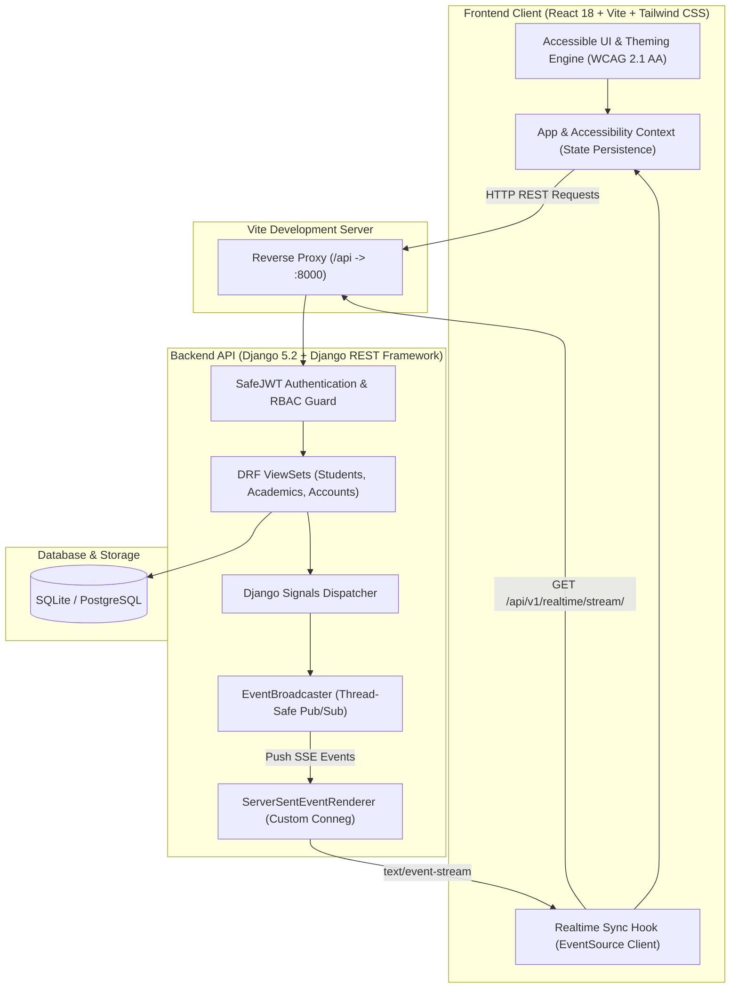
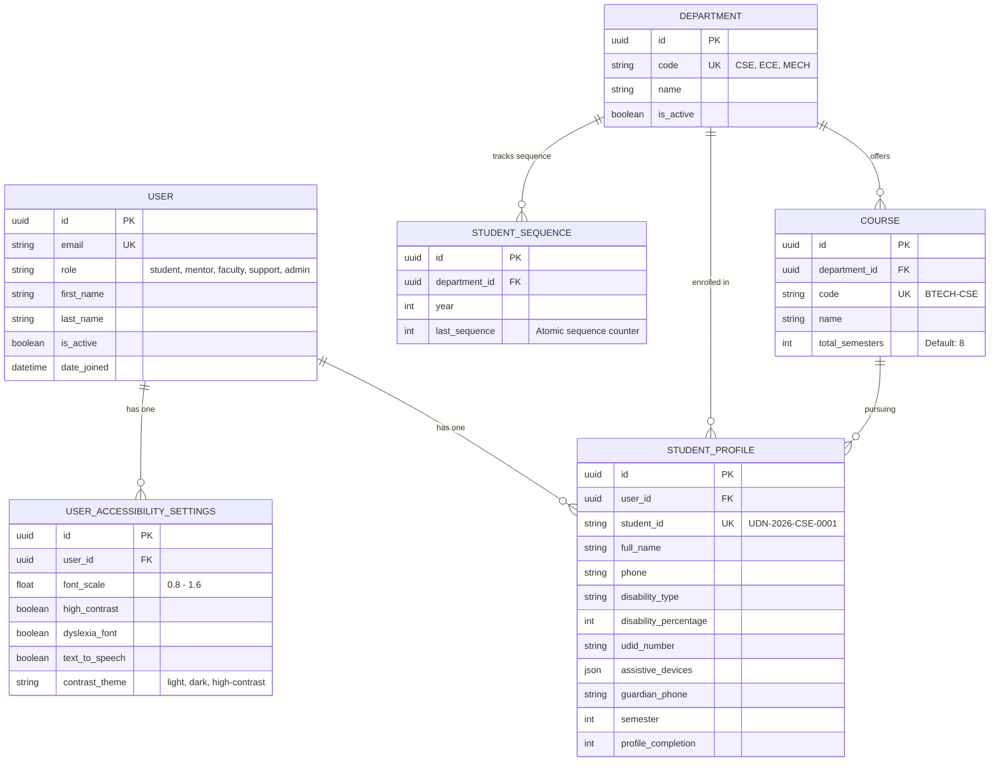

# 🎓 UDAAN – Specially Abled Student Mentorship & Academic Enablement Platform

<div align="center">

[](https://opensource.org/licenses/MIT)
[](https://www.djangoproject.com/)
[](https://www.django-rest-framework.org/)
[](https://react.dev/)
[](https://vitejs.dev/)
[](https://tailwindcss.com/)
[](https://www.w3.org/WAI/standards-guidelines/wcag/)
[](https://pytest.org/)

**Tagline:** *Empowering Abilities. Enabling Futures.*  
An enterprise-grade, accessibility-first web ecosystem bridging specially abled college students with personalized mentorship, adaptive academics, assistive support coordination, and administrative enablement.

</div>

---

## 📑 Table of Contents
1. [Executive Summary & Problem Statement](#-executive-summary--problem-statement)
2. [Key Highlights & Faculty Quick-Look](#-key-highlights--faculty-quick-look)
3. [System Architecture](#-system-architecture)
4. [Role-Based Modules & User Personas](#-role-based-modules--user-personas)
5. [Accessibility Engine (WCAG 2.1 AA)](#-accessibility-engine-wcag-21-aa)
6. [Real-Time SSE Synchronization Architecture](#-real-time-sse-synchronization-architecture)
7. [Security, RBAC & Privacy Protection](#-security-rbac--privacy-protection)
8. [REST API Specification](#-rest-api-specification)
9. [Technology Stack](#-technology-stack)
10. [Database Schema & Entity Relations](#-database-schema--entity-relations)
11. [Installation & Setup Guide](#-installation--setup-guide)
12. [Faculty Evaluation Accounts](#-faculty-evaluation-accounts)
13. [Automated Testing & QA](#-automated-testing--qa)
14. [Repository Directory Structure](#-repository-directory-structure)
15. [License & Acknowledgments](#-license--acknowledgments)

---

## 🎯 Executive Summary & Problem Statement

Higher education institutions often struggle to provide customized, dignity-affirming support for students with diverse physical, sensory, and learning disabilities. Specially abled students encounter barriers such as:
- Fragmented access to disability accommodations (scribes, assistive tech, extended exam durations).
- Isolation and lack of senior mentors who understand lived disability experiences.
- Web portals lacking accessibility compliance (violating RPwD Act 2016 and NEP 2020 inclusion guidelines).
- Data privacy concerns surrounding disclosure of medical records and UDID certificates.

**UDAAN** solves this through a centralized, full-stack, universally accessible platform uniting **Students**, **Mentors**, **Faculty**, **Disability Support Coordinators**, and **College Administrators** in an integrated, real-time digital ecosystem.

---

## 🌟 Key Highlights & Faculty Quick-Look

- **Accessibility-First Design**: Native high-contrast color palettes, live font-scaling (0.8x to 1.6x), OpenDyslexic font engine, Web Speech API Text-to-Speech (TTS), reading guides, and ARIA-live screen-reader alerts.
- **Enterprise Django 5.2 + DRF REST Backend**: Robust relational architecture with SQLite/PostgreSQL support, atomic student ID generation (`UDN-YYYY-DEPT-XXXX`), and centralized plain-language error formatting.
- **Live Real-Time Synchronization (SSE)**: Built-in Server-Sent Events engine broadcasting student status, profile changes, and academic updates instantly across multi-user browser sessions without heavy external message brokers.
- **Privacy-Shielded Profiling**: Strict object-level privacy filtering masking UDID numbers, medical percentages, and guardian emergency contacts from unauthorized viewers while preserving accessibility accommodation needs.
- **Role-Based Access Control (RBAC)**: Distinct dashboards and permissions across 5 specialized roles (`student`, `mentor`, `faculty`, `support`, `admin`).
- **30+ Automated Pytest Tests**: Comprehensive test suite verifying authentication security, token rotation, atomic sequence concurrency, RBAC permissions, and SSE endpoint compliance.

---

## 🏛️ System Architecture



---

## 👥 Role-Based Modules & User Personas

### 1. 🎓 Specially Abled Students (`/student/*`)
- **Accessibility Settings**: Persistent preferences for contrast, font-scaling, dyslexia font, and text-to-speech toggles synced to backend.
- **Adaptive Dashboard**: Real-time overview of assigned mentors, upcoming sessions, academic attendance, and accommodation requests.
- **Smart Mentor Discovery**: Filter and request mentorship from peers/seniors matching specific disability domains and engineering branches.
- **Assistive Learning Hub**: Curated accessible study materials, screen-magnifier simulations, speech-to-text dictation, and exam accommodation request tracker.
- **Personal Profile Management**: Self-service management of contact details, assistive device inventory, and disability documentation.

### 2. 🤝 Mentors (`/mentor/*`)
- **Mentorship Requests**: Review, accept, or reschedule incoming guidance requests from juniors.
- **Learning Plans**: Build customized milestone-driven roadmaps adapted to each mentee's pace and accommodations.
- **Session Scheduling**: Coordinate 1-on-1 virtual or in-person mentoring meetings with automated agenda notes.
- **Privacy-Protected Student Directory**: View mentee academic data with automatic masking of sensitive medical records.

### 3. 👩‍🏫 Faculty Members (`/faculty/*`)
- **Course & Materials Portal**: Publish accessible lecture notes, audio transcriptions, and structured assignments.
- **Exam Accommodation Oversight**: Monitor special provisions (scribes, extra time, lab assistants) for enrolled students.
- **Academic Progress Tracking**: Monitor student submissions, grades, and attendance metrics.

### 4. 🦽 Disability Support Coordinators (`/support/*`)
- **Accommodation Ticket Management**: Review and resolve requests for wheelchair ramps, lab equipment, assistive software, and scribes.
- **Status Workflows**: Assign staff, update fulfillment stages (Open, In Progress, Resolved), and communicate with students.

### 5. 🛠️ College Administrators (`/admin/*`)
- **Academic Hierarchy Management**: Full CRUD operations for Academic Departments and Degree Programs with validation.
- **Student Lifecycle Management**: Instant one-click student deactivation/reactivation with live cross-session broadcast.
- **Institutional Analytics**: Real-time distribution charts showing enrollment by department, disability categories, and mentorship ratios.

---

## ♿ Accessibility Engine (WCAG 2.1 AA)

UDAAN incorporates a dedicated accessibility toolbar accessible globally via the header or `<Alt + A>`:

| Feature | Implementation Details | WCAG Criterion |
| :--- | :--- | :--- |
| **High Contrast Themes** | Default Light, Midnight Dark, and High-Contrast Black/Yellow (`#000000` / `#FFFF00`) with >7:1 contrast ratios | 1.4.3 Contrast (Minimum), 1.4.6 Contrast (Enhanced) |
| **Dynamic Font Scaling** | Proportional font resizing from **80% to 160%** without layout breakage | 1.4.4 Resize Text |
| **Dyslexia-Friendly Typography** | Integrated **OpenDyslexic** specialized font for cognitive reading ease | 1.4.12 Text Spacing |
| **Screen Reader Optimization** | Semantic HTML5 tags, ARIA-expanded states, `aria-live="polite"` dynamic alerts, and Skip-to-Main-Content navigation | 4.1.2 Name, Role, Value, 2.4.1 Bypass Blocks |
| **Speech Synthesis (TTS)** | Native Web Speech API integration reading aloud highlighted text or page summaries | 1.1.1 Non-text Content |
| **Keyboard Accessibility** | 100% operable via keyboard alone; prominent focus rings (`focus:ring-2 focus:ring-offset-2`) | 2.1.1 Keyboard Accessible |

---

## ⚡ Real-Time SSE Synchronization Architecture

Unlike polling-based architectures that strain servers or complex WebSocket configurations requiring dedicated Redis brokers, UDAAN leverages an efficient **Server-Sent Events (SSE)** architecture:

```
[Student Mutation] ──► [Django ORM Save] ──► [Django post_save Signal]
                                                    │
                                                    ▼
                                           [EventBroadcaster]
                                         (Thread-safe Pub/Sub)
                                                    │
                                                    ▼
                                         [RealtimeStreamView]
                                       (text/event-stream SSE)
                                                    │
                      ┌─────────────────────────────┴─────────────────────────────┐
                      ▼                                                           ▼
         [Admin Management Tab]                                      [Student Profile Tab]
      (Instant Status Badge Sync)                                   (Live Preference Sync)
```

- **Thread-Safe In-Memory Broadcaster**: Zero external message broker dependency; manages subscriber queues with thread-safe locks.
- **DRF Content Negotiation Resiliency**: Custom `ServerSentEventRenderer` ensures `Accept: text/event-stream` requests from browser `EventSource` return `200 OK` rather than `406 Not Acceptable`.
- **Automatic Heartbeat & Reconnection**: 15-second heartbeat comments prevent HTTP timeout; client-side exponential backoff reconnects seamlessly.

---

## 🔒 Security, RBAC & Privacy Protection

- **SafeJWT Authentication**: Dual-token architecture (Access Token: 60 mins, Refresh Token: 7 days) with cryptographic signing, token rotation, and server-side blacklisting on logout.
- **Privacy-Shielded Serializers**:
  - `StudentMeSerializer`: Full access granted exclusively to the profile owner and system administrators.
  - `StudentPublicSerializer`: Applied when mentors or faculty view students; automatically excludes sensitive fields (`udid_number`, `disability_percentage`, `phone`, `guardian_phone`, `accommodation_needs`).
- **Atomic ID Generation**: Sequence counter table with transactional atomic increments prevents race conditions when concurrent students register in the same department and year.
- **Accessible Error Envelope**: Standardized error payloads readable by both UI form handlers and screen readers:
  ```json
  {
    "success": false,
    "error": {
      "code": "VALIDATION_ERROR",
      "message": "Semester must be between 1 and 8 for B.Tech.",
      "fields": { "semester": ["Must be between 1 and 8."] }
    }
  }
  ```

---

## 📡 REST API Specification

| Method | Endpoint | Access | Purpose |
| :--- | :--- | :--- | :--- |
| `POST` | `/api/v1/auth/login` | Public | Authenticate user & return JWT tokens |
| `POST` | `/api/v1/auth/register` | Public | Register new student profile with atomic ID |
| `POST` | `/api/v1/auth/logout` | Authenticated | Blacklist refresh token & terminate session |
| `POST` | `/api/v1/auth/forgot-password` | Public | Issue 15-minute password reset OTP |
| `POST` | `/api/v1/auth/reset-password` | Public | Verify OTP & update user password |
| `GET` | `/api/v1/students/me` | Owner/Admin | Retrieve logged-in student's complete profile |
| `PATCH`| `/api/v1/students/me/personal` | Owner/Admin | Update personal & guardian contact details |
| `PATCH`| `/api/v1/students/me/academics` | Owner/Admin | Update department/course/semester |
| `PUT` | `/api/v1/students/me/accessibility` | Owner/Admin | Persist accessibility settings toolbar state |
| `DELETE`| `/api/v1/students/me` | Owner/Admin | Soft-deactivate student account |
| `GET` | `/api/v1/students/<student_id>` | Authenticated | View student profile (privacy-filtered for non-owners) |
| `GET` | `/api/v1/students` | Admin/Staff | Paginated & filterable list of all student profiles |
| `PATCH`| `/api/v1/students/<id>/status` | Admin | Toggle student active/inactive status |
| `GET` | `/api/v1/academics/departments` | Public | List all academic departments |
| `POST` | `/api/v1/academics/departments` | Admin | Create a new academic department |
| `GET` | `/api/v1/academics/courses` | Public | List degree courses with semester limits |
| `GET` | `/api/v1/realtime/stream/` | Public | Server-Sent Events (SSE) real-time event stream |

---

## 💻 Technology Stack

### Frontend
- **Framework**: React 18 (Vite Bundler)
- **Styling**: Tailwind CSS, PostCSS, Autoprefixer
- **Routing**: React Router DOM v7
- **Icons**: Lucide React
- **Visualizations**: Recharts (Accessible SVG Charts)
- **Forms & Validation**: React Hook Form + Zod
- **Animations**: Framer Motion (respects `prefers-reduced-motion`)

### Backend
- **Runtime**: Python 3.12+
- **Framework**: Django 5.2 & Django REST Framework (DRF) 3.15
- **Authentication**: `djangorestframework-simplejwt`
- **CORS Handling**: `django-cors-headers`
- **Filtering**: `django-filter`
- **Database**: SQLite (Development / Demo) / PostgreSQL (Production ready)
- **Testing**: `pytest`, `pytest-django`, `pytest-asyncio`

---

## 🗄️ Database Schema & Entity Relations



---

## 🚀 Installation & Setup Guide

### Prerequisites
- **Node.js**: v18.0.0 or higher ([Download Node.js](https://nodejs.org/))
- **Python**: v3.10, 3.11, or 3.12 ([Download Python](https://www.python.org/))
- **Git**: Installed and configured on your system.

---

### Step 1: Clone the Repository
```bash
git clone https://github.com/SouvikSaha2006/UDAAN-Mentorship-Platform-.git
cd UDAAN-Mentorship-Platform-
```

---

### Step 2: Backend Setup (Django + DRF)

1. Open a terminal and navigate to the `backend` folder:
   ```bash
   cd backend
   ```

2. *(Recommended)* Create and activate a Python virtual environment:
   ```bash
   # Windows (PowerShell)
   python -m venv venv
   .\venv\Scripts\Activate.ps1

   # macOS / Linux
   python3 -m venv venv
   source venv/bin/activate
   ```

3. Install required Python packages:
   ```bash
   pip install -r requirements.txt
   ```

4. Run database migrations:
   ```bash
   python manage.py migrate
   ```

5. Seed demo database with comprehensive mock departments, courses, and accounts:
   ```bash
   python manage.py seed_udaan
   ```

6. Start the Django development server:
   ```bash
   python manage.py runserver 8000
   ```
   > Backend API is now live at: **`http://localhost:8000/api/v1/`**

---

### Step 3: Frontend Setup (React + Vite)

1. Open a **new, separate terminal** in the project root directory:
   ```bash
   cd UDAAN-Mentorship-Platform-
   ```

2. Install Node dependencies:
   ```bash
   npm install
   ```

3. Launch the Vite development server:
   ```bash
   npm run dev
   ```
   > Frontend Application is now running at: **`http://localhost:5173/`**

---

## 🔑 Faculty Evaluation Accounts

All pre-seeded demo accounts are configured with the universal password:
👉 **`Password@123`**

| Persona | Email | Accessible Portal Path | Evaluation Highlights |
| :--- | :--- | :--- | :--- |
| **Specially Abled Student** | `student@udaan.edu` | `/student/dashboard` | Low Vision profile, High-contrast mode, Assistive Learning Hub, Mentor matching |
| **Senior Mentor** | `mentor@udaan.edu` | `/mentor/dashboard` | Mentorship session manager, learning plans, privacy-shielded mentee views |
| **Faculty Member** | `faculty@udaan.edu` | `/faculty/dashboard` | Course materials repository, exam accommodation monitor |
| **Support Coordinator** | `support@udaan.edu` | `/support/dashboard` | Assistive device & scribe ticket queue, status workflows |
| **College Administrator** | `admin@udaan.edu` | `/admin/dashboard` | Live student status toggle (SSE), department/course CRUD, analytics |

---

## 🧪 Automated Testing & QA

The project includes an automated test suite verifying core business logic, RBAC security, token handling, and concurrency safety:

```bash
# Navigate to backend directory
cd backend

# Execute complete test suite via pytest
pytest -v
```

### Verified Test Scenarios
- `test_student_me_profile_updates`: Validates profile updates, phone verification, and semester bound validation (`1 <= semester <= total_semesters`).
- `test_accessibility_persistence`: Verifies toolbar settings persist to database and sync on subsequent logins.
- `test_privacy_filtering_mentor_vs_owner`: Verifies sensitive medical and guardian records are strictly stripped for mentor/faculty views.
- `test_soft_deactivation`: Validates that deactivated students are immediately barred from logging in with HTTP 403.
- `test_atomic_student_id_uniqueness`: High-concurrency test verifying zero duplicate student IDs generated under parallel requests.
- `test_realtime_stream_accepts_sse_header`: Ensures SSE endpoint accepts `Accept: text/event-stream` returning `200 OK` and proper stream headers.

---

## 📁 Repository Directory Structure

```text
UDAAN-Mentorship-Platform-/
├── backend/                             # Django REST Framework Backend
│   ├── academics/                       # Departments, Courses & Sequence models
│   │   ├── models.py
│   │   ├── serializers.py
│   │   ├── views.py
│   │   └── tests.py
│   ├── accounts/                        # Custom User, SafeJWT & RBAC
│   │   ├── authentication.py            # SafeJWT implementation
│   │   ├── models.py
│   │   ├── serializers.py
│   │   └── views.py
│   ├── students/                        # Profiles, Accessibility & SSE Events
│   │   ├── events.py                    # Thread-safe SSE broadcaster & SSERenderer
│   │   ├── id_generator.py              # Atomic student ID sequence generator
│   │   ├── models.py
│   │   ├── signals.py                   # Real-time event dispatching signals
│   │   ├── views.py
│   │   └── tests.py
│   ├── udaan_backend/                   # Project root configuration
│   │   ├── exceptions.py                # Accessible DRF exception handler
│   │   ├── settings.py
│   │   └── urls.py
│   ├── manage.py
│   ├── pytest.ini
│   └── requirements.txt
│
├── src/                                 # React 18 Frontend Source
│   ├── components/
│   │   ├── accessibility/               # Accessibility Toolbar, Speech & Reading Guides
│   │   ├── common/                      # Reusable accessible buttons, inputs, modals
│   │   └── layout/                      # Navbar, Sidebar, Footer & Skip Links
│   ├── context/
│   │   ├── AccessibilityContext.jsx     # Font scale, contrast theme & TTS state
│   │   ├── AppDataContext.jsx           # Live cached app state & SSE sync dispatch
│   │   └── AuthContext.jsx              # JWT tokens, user role & session management
│   ├── hooks/
│   │   ├── useAccessibility.js          # Accessibility shortcut hook
│   │   └── useRealtimeSync.js           # Resilient EventSource SSE client hook
│   ├── pages/
│   │   ├── admin/                       # Admin Dashboard, Student Management, Analytics
│   │   ├── auth/                        # Login, Register, Forgot Password
│   │   ├── faculty/                     # Faculty Dashboard, Courses, Exams
│   │   ├── mentor/                      # Mentor Dashboard, Sessions, Learning Plans
│   │   ├── public/                      # Landing Page, About, How It Works
│   │   ├── shared/                      # Messages, Notifications
│   │   ├── student/                     # Student Dashboard, Profile, Assistive Hub
│   │   └── support/                     # Support Coordinator Ticket Management
│   ├── services/
│   │   └── api.js                       # Axios / Fetch client with JWT interceptor
│   ├── App.jsx                          # Route definitions & Role guards
│   ├── index.css                        # Tailwind CSS directives & high-contrast themes
│   └── main.jsx                         # React root mount
│
├── index.html
├── package.json
├── tailwind.config.js
├── vite.config.js                       # Vite proxy config (/api -> localhost:8000)
└── README.md                            # Comprehensive Project Documentation
```

---

## 📄 License & Acknowledgments

- **License**: Distributed under the MIT License.
- **Inspiration & Guidance**: Designed in accordance with the **Rights of Persons with Disabilities (RPwD) Act 2016** and the inclusive education recommendations of the **National Education Policy (NEP) 2020**.
- **Special Thanks**: Dedicated to all educators, mentors, and specially abled students whose determination drives inclusive innovation.

<div align="center">
  <b>Built with ❤️ for an Inclusive, Accessible, and Barrier-Free Academic Future.</b>
</div>
